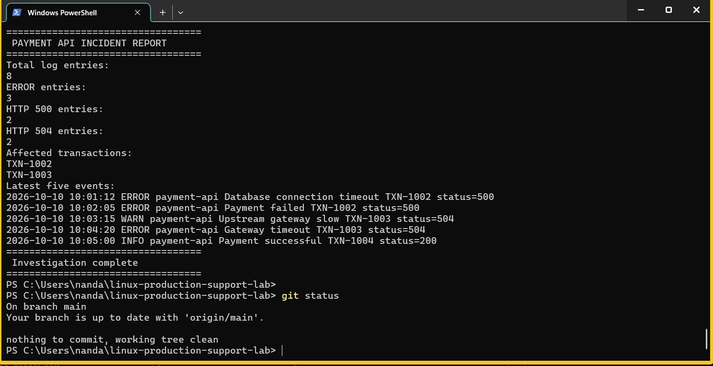

# Linux Production Support & Incident Troubleshooting Lab

A hands-on Linux production support lab demonstrating application log analysis, Bash scripting, incident investigation, and root cause analysis using Ubuntu 24.04 and Docker.

## Project Overview

This project simulates a payment application incident using fictional log data.

The goal is to demonstrate practical L2/L3 production support troubleshooting techniques.

## Technologies Used

- Ubuntu 24.04 LTS
- Docker
- Linux Command Line
- Bash Scripting
- grep, tail, df, free, wc, sort
- Git and GitHub
- Incident Management and RCA

## Incident Scenario

A simulated payment application experienced HTTP 500 and HTTP 504 errors.

The investigation identified:

| Metric | Result |
|---|---|
| Total log entries | 8 |
| ERROR entries | 3 |
| HTTP 500 entries | 2 |
| HTTP 504 entries | 2 |
| Affected transactions | TXN-1002, TXN-1003 |

## Investigation Commands

```bash
pwd
whoami
cat /etc/os-release
df -h
free -h
grep "ERROR" logs/payment-api.log
grep "status=500" logs/payment-api.log
tail -n 5 logs/payment-api.log
```

## Automated Troubleshooting

A Bash script automatically analyzes application logs and reports:

- Total log entries
- ERROR count
- HTTP 500 count
- HTTP 504 count
- Affected transaction IDs
- Latest application events

### Run the Lab

Requires Docker Desktop.

**Windows PowerShell:**

```powershell
docker run --rm -v "${PWD}:/opt/support-lab" ubuntu:24.04 bash /opt/support-lab/scripts/investigate.sh
```

Run the command from the repository root.

## Project Structure

```text
linux-production-support-lab/
├── README.md
├── .gitattributes
├── docs/
│   └── INCIDENT-RCA-001.md
├── logs/
│   └── payment-api.log
├── scripts/
│   └── investigate.sh
└── screenshots/
    └── incident-investigation.png
```

## Incident Findings

**TXN-1002:** Database connection timeout followed by HTTP 500 payment failure.

**TXN-1003:** Upstream gateway slowdown followed by HTTP 504 gateway timeout.

These findings are based on fictional application logs. The underlying root causes have not been conclusively established.

## Investigation Screenshot

The following screenshot shows the successful execution of the automated Linux incident investigation script using Docker.



The script identifies application errors, HTTP 500/504 failures, affected transactions, and the latest application log events.

## Incident RCA

[Read the Incident RCA Report](docs/INCIDENT-RCA-001.md)

## Skills Demonstrated

- Linux Production Support
- L2/L3 Application Troubleshooting
- Bash Scripting
- Application Log Analysis
- HTTP Error Investigation
- Incident Management
- Root Cause Analysis
- Technical Documentation

## Data Safety

All application logs and transaction identifiers are synthetic.

No employer data, customer records, credentials, or proprietary information are included.

## Author

[Praveen Koppad - GitHub Profile](https://github.com/praveenkoppad916-hue)
